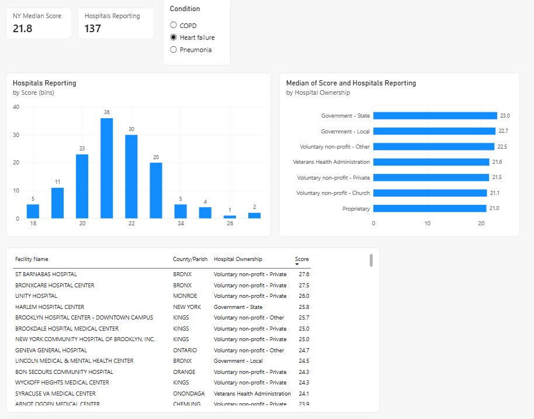
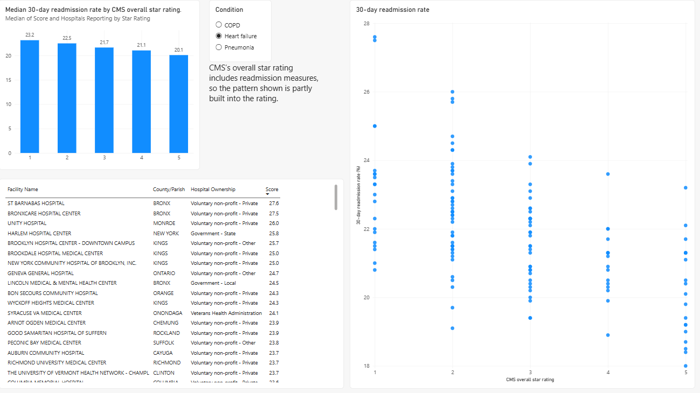

# NY Hospital 30-Day Readmission Rates

A two-page Power BI dashboard comparing New York hospitals on CMS 30-day readmission rates for heart failure, pneumonia & COPD. Built from two public CMS Provider Data Catalog files.

## Question

How do New York hospitals compare on 30-day readmission rates for heart failure, pneumonia & COPD, and does the rate differ by CMS overall star rating or by hospital ownership?

## Data

| File | CMS dataset | Used for |
|---|---|---|
| Unplanned Hospital Visits - Hospital | [632h-zaca](https://data.cms.gov/provider-data/dataset/632h-zaca) | Readmission rate per hospital & measure |
| Hospital General Information | [xubh-q36u](https://data.cms.gov/provider-data/dataset/xubh-q36u) | Hospital type, ownership & overall star rating |

Both files were downloaded in October 2026. The three readmission measures cover discharges from 07/01/2023 to 06/30/2025. The files join on Facility ID, CMS's six-character provider ID.

## Method

1. Filter both files to State = NY. The Unplanned Hospital Visits file holds 163 NY hospitals.
2. Keep three measures: READM_30_HF (heart failure), READM_30_PN (pneumonia) & READM_30_COPD.
3. Convert Score from text to a decimal number. Rows where CMS reports "Not Available" drop out of the charts; they are not counted as zero.
4. Keep Facility ID as text. Ten NY IDs end in a letter, such as 33009F for the Albany VA Medical Center, & converting the column to a number deletes those hospitals.
5. Merge the two files with a left outer join on Facility ID, then bring in Hospital Ownership & Hospital overall rating.
6. Convert Hospital overall rating to a whole number, with "Not Available" as blank, & call it Star Rating.
7. Build every visual behind a single-select Condition slicer, because the three measures run on different scales.

Tools: Power BI Desktop & Power Query.

## Findings

Number of NY hospitals with a published rate, & the spread of those rates:

| Measure | Hospitals with a rate | Median (%) | Lowest (%) | Highest (%) |
|---|---|---|---|---|
| Heart failure | 137 of 163 | 21.8 | 18.0 | 27.6 |
| Pneumonia | 143 of 163 | 17.5 | 15.4 | 21.4 |
| COPD | 136 of 163 | 20.3 | 16.8 | 24.0 |

Heart failure rates cluster in a narrow band. 89 of the 137 hospitals fall between 20.0% & 22.9%, & 12 sit at 24.0% or above. The highest rates belong to St Barnabas Hospital (27.6%), BronxCare Hospital Center (27.5%) & Unity Hospital (26.0%). The lowest is Northern Westchester Hospital at 18.0%.

The median heart failure rate for the 3,253 hospitals nationwide with a score in the same file is 21.3%, against 21.8% for New York.

Median heart failure rate falls at every step from 1 star to 5 stars: 23.2%, 22.5%, 21.7%, 21.1% & 20.1%, a gap of 3.1 points between the ends. The 1-star group has 20 hospitals & the 5-star group has 19. The scatter plot shows wide overlap between star levels. Some 5-star hospitals sit above 22%, & some 2-star hospitals sit below 20%.

Heart failure rate by hospital ownership:

| Ownership | Hospitals | Median (%) |
|---|---|---|
| Government - State | 5 | 23.0 |
| Government - Local | 8 | 22.7 |
| Voluntary non-profit - Other | 7 | 22.5 |
| Veterans Health Administration | 8 | 21.6 |
| Voluntary non-profit - Private | 101 | 21.5 |
| Voluntary non-profit - Church | 7 | 21.1 |
| Proprietary | 1 | 21.0 |

Voluntary non-profit - Private hospitals account for 101 of the 137. The medians span 2.0 points, from 21.0% to 23.0%, & the two ends of that range are the smallest groups.

## Limitations

- CMS reports no better, same or worse comparison to the national rate for any of the 416 scored NY hospital-measure rows on these three measures, & no confidence interval. Hospitals can be ranked by raw rate but can't be called statistically different from each other.
- Hospitals with few eligible cases have no published rate. 26 NY hospitals have none for heart failure, 20 for pneumonia & 27 for COPD.
- CMS builds its overall star rating partly from readmission measures, so the star-rating pattern on page 2 is partly built into the rating.
- Six of the seven ownership groups have 8 hospitals or fewer, & Proprietary has 1, so its 21.0% is a single hospital's rate. Treat the ownership medians as descriptive.
- The Association of Health Care Journalists describes CMS readmission measures as covering fee-for-service Medicare patients ages 65 & older, so the rates say nothing about a hospital's younger or privately insured patients.

## Sources

- CMS Provider Data Catalog, Unplanned Hospital Visits - Hospital: https://data.cms.gov/provider-data/dataset/632h-zaca
- CMS Provider Data Catalog, Hospital General Information: https://data.cms.gov/provider-data/dataset/xubh-q36u
